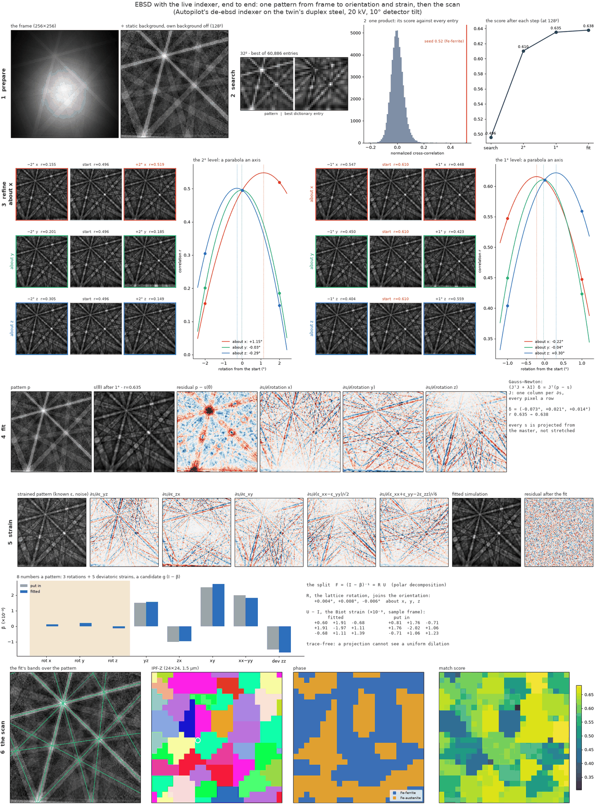

=======================
Indexing and refinement
=======================

:mod:`de_ebsd.index` is the inverse of :mod:`de_ebsd.sim`: simulation generates
patterns from orientations, indexing recovers orientations from patterns. Both
are GPU-native and differentiable. It depends only on orix and on de-ebsd's own
detector geometry, never on kikuchipy, and emits orix ``Rotation`` and
``CrystalMap`` objects, so other tools can call it as a backend.

Dictionary indexing
===================

:class:`~de_ebsd.index.DictionaryIndexer` projects the master over a
fundamental-zone sample of orientations and scores every pattern against every
entry by one normalized cross-correlation matrix product. The grid is coarse by
design: it seeds a refinement.

Spherical indexing
==================

:class:`~de_ebsd.index.SphericalIndexer` follows EMSphInx (Lenthe, Singh and De
Graef, 2019). The master pattern is a function ``M(n)`` on the unit sphere.
Back-projecting an experimental pattern gives ``E(n)``, and the cross-correlation
as a function of the trial orientation ``g``,

.. math::

    C(g) = \langle E(n),\, M(g \cdot n) \rangle ,

is a function on SO(3). Expanding both in spherical harmonics up to a bandwidth
``L`` makes ``C(g)`` band-limited, with Wigner-D coefficients equal to the outer
product of the two harmonic spectra. One inverse SO(3) transform (SOFT) yields
``C(g)`` on a whole grid of orientations at once, in ``O(L^3 log L)``, instead
of a brute-force sweep. The peak is the orientation.

The pipeline is:

1. back-project each pattern to the sphere (``index.backproject``);
2. transform the master once and the patterns in batches to spherical
   harmonics (``index.spherical.harmonics``);
3. correlate over SO(3) with the Wigner-D transform
   (``index.spherical.wigner``, ``index.spherical.correlation``);
4. take the peak (``index.spherical.indexer``); multi-candidate peak extraction
   is not implemented;
5. refine, then assemble an orix ``CrystalMap`` (``index.io``).

The returned orientation is the sample orientation passed to
``MasterPattern.project``, with no inverse and no transpose.

Because the whole path is differentiable, a coarse index can be sharpened by
gradient ascent on the correlation (``index.refine``), the pattern center can be
refined jointly by autograd through the back-projection, and a master that is
itself differentiable in crystal parameters opens forward-model fitting of a
structure to a scan.

Refinement
==========

- ``refine_orientation`` maximizes a masked spherical correlation by Adam (which
  also refines the pattern center) or by a batched Levenberg-Marquardt step with
  an analytic Jacobian (orientation only).
- ``refine_hr`` samples a few thousand band-edge pixels per pattern and runs
  Levenberg-Marquardt on those, jointly in orientation and, optionally, pattern
  center.
- ``determine_pattern_center`` calibrates one pattern center shared by many
  patterns, alternating per-pattern orientation refinement with a global step,
  over a schedule of progressively less blurred masters.
- ``hrebsd`` measures lattice strain and rotation by cross-correlating regions of
  a pattern against a reference, solving the shift equation for the eight
  trace-free components of the displacement gradient; a second pass remaps the
  reference through the gnomonic geometry.

Live indexing
=============

:class:`~de_ebsd.index.LiveIndexer` indexes a camera's frames where they already
are, on the GPU, in a fixed number of batched steps. Frames are divided by the
scan's running static background and have their own dynamic background removed;
one matrix product against every phase's stacked dictionary gives the phase and
a seed orientation; a local dictionary of seven projections per level, with a
parabola through each axis's scores, refines the seed. The same machinery
calibrates the pattern center from a buffer of frames and fits each pattern's
strain together with its orientation. Fused CUDA kernels, compiled at run time
when CuPy is installed, do the projection and scoring in one pass.

It is the one multi-phase indexer, for either physics. Each phase's master may be
a dynamical :class:`~de_ebsd.sim.MasterPattern` or a kinematic
:class:`~de_ebsd.sim.KinematicMaster`, sampled onto the same Lambert grid
(:meth:`~de_ebsd.sim.KinematicMaster.to_master_pattern`), so a CPU without the
minutes a dynamical master takes indexes several phases the same way a GPU does
(:func:`~de_ebsd.index.live.dynamical_indexing_available` says which to use).
Frames may be NumPy, torch or CuPy arrays; a GPU array is read in place through
DLPack. Orientations and strains come back in OIM's (EDAX TSL) sample frame,
ready for an ``.ang`` as they are (:doc:`/user/conventions`).

The design goal is a cost per buffer that is fixed and known in advance: every
step below is a batched operation over the whole buffer, and nothing loops over
patterns or phases. Only each pattern's phase, orientation and score -- and its
strain, when asked for -- leave the device.

         and strain, then the scan's maps.
   :width: 100%

   The live indexer end to end, on de-twin's duplex steel (20 kV, 10 degree
   detector tilt). (1) The frame, divided by the static background and its own
   background removed. (2) One product against every dictionary entry; the best
   is the seed. (3) The 2 degree level, then the 1 degree level: the start and
   one step either way about x, y and z, each scored, and a parabola an axis
   moving to its peak. (4) One Gauss-Newton step on the three rotations: the
   residual against the simulation, the derivative of the simulation about each
   axis, and the step they solve for; every simulation is projected from the
   master. (5) The same fit with the five deviatoric strains, on a pattern
   simulated with a known strain and noise (the twin's steel has none): the
   eight numbers fitted against those put in, and the polar decomposition into
   the lattice rotation and the Biot strain. (6) Every pattern of the scan the
   same way: the fitted bands, and the IPF, phase and score maps.

Preparing the patterns
----------------------

:meth:`~de_ebsd.index.LiveIndexer.prepare` turns a buffer of raw frames into the
rows that are scored, in three steps:

1. Each frame is averaged over the whole sensor down to the refine shape
   (``refine_shape``, 128 x 128 by default). Averaging the whole sensor, rather
   than cropping, keeps every band and every count.
2. It is divided by the scan's **static background**, the running mean of the
   frames the scan has seen (:meth:`~de_ebsd.index.LiveIndexer.observe`). A live
   scan's frames come from a few grains at a time, so the mean waits for 32
   frames before it is used; :meth:`~de_ebsd.index.LiveIndexer.restart_static`
   starts it from frames chosen from all over the specimen (a survey's), which
   average their bands away in fewer. On a single crystal every frame carries
   the same bands, so the mean would keep them: there it is blurred.
3. The pattern's own slowly varying **dynamic background** is removed, the rows
   are normalized to zero mean and unit length, and a copy is averaged again to
   the search shape (``search_shape``, 32 x 32 by default).

Whatever of the grains' bands the static background still holds -- the
**ghost** -- is tracked from the orientations already fitted, so the strain fit
below can take it out of patterns and simulations alike.

Searching the dictionary
------------------------

Each phase's master is projected at the search shape over a sample of its
fundamental zone, at the dictionary's angular step: about 30,000 entries for a
cubic phase at 3 degrees. Every phase's entries are stacked into one matrix, so
:meth:`~de_ebsd.index.LiveIndexer.search` is one matrix product of the buffer
against that matrix: the best entry gives the phase and a seed orientation
together, and the score is the normalized cross-correlation. A low-symmetry
phase's dictionary is scored 65,536 entries at a time, keeping each pattern's
best so far, so the scores never outgrow one chunk.

The search's copy of the masters is blurred by 2 degrees on the sphere. A sharp
dynamical pattern's score falls so steeply away from its orientation that at a
3-degree step no entry may be near enough, and a distant wrong one wins; on a
twin scan 6-9 % of the patterns landed 40-60 degrees off unblurred, none at
2 degrees. The search only has to land in the right basin -- the refine does the
rest.

The in-plane search
-------------------

``LiveIndexer(..., search="inplane")`` replaces the dictionary with a search
that factors the in-plane rotation out
(:class:`~de_ebsd.index.live.inplane.InplaneSearch`). Turning the crystal about
the axis through the pattern center normal to the screen turns its pattern about
the pattern center by the same angle, so every orientation is

.. math::

    g = g_0(u)\, R_n(\theta),

with :math:`n` the screen normal in the sample frame, :math:`u = g\,n` the
crystal direction along it (two angles, on the sphere modulo the point group's
proper rotations), :math:`g_0(u)` the smallest rotation taking :math:`n` to
:math:`u`, and :math:`\theta` the turn about :math:`n`. On a polar grid about the
pattern center -- radii :math:`\rho_k` by angles :math:`\phi_j` -- the pattern of
:math:`g_0 R_n(\theta)` at :math:`\phi` is :math:`g_0`'s at :math:`\phi +
\theta`: a shift along :math:`j`. One template per sphere direction holds every
in-plane angle, and scoring a pattern against all of them is a correlation along
the angle.

**The two-angle grid.** The sphere is sampled icosahedrally and kept where it
lies in the Dirichlet region of a generic direction under the proper rotations
(``u . k >= (S u) . k`` for every symmetry ``S``), plus half a step so that a
direction on the region's edge keeps its neighbours. Every point group's
Dirichlet region of a point it moves nowhere is a fundamental region, so one rule
serves all; the kept grid covers the sphere exactly as well as the whole
icosahedral grid does, from a little over :math:`1/|S|` of it. At an equivalent
step :math:`s` (the flat dictionary's resolution it stands in for) the sphere
and in-plane steps are :math:`1.25 s`, the in-plane step no finer than 1.875
degrees: the grid whose 99th-percentile covering radius matches the
fundamental-zone grid's.

**The masked normalization.** The screen is a rectangle off center on the polar
grid, so each template is seen through a mask that depends on the pattern
center, not on the template. With :math:`w_{kj}` the polar area weight
:math:`\rho_k` on the screen and zero off it, :math:`q` the pattern made
mean-free and unit over the visible samples, and :math:`t` the template, the
normalized cross-correlation at in-plane shift :math:`s` is

.. math::

    \mathrm{NCC}(u, s) = \frac{\sum_{kj} w_{kj}\, q_{kj}\, t_{k,j+s}}{\sqrt{D(u,
    s)}}, \qquad D(u, s) = A_2(s) - \frac{A_1(s)^2}{\sum_{kj} w_{kj}}, \qquad
    A_p(s) = \sum_{kj} w_{kj}\, t_{k,j+s}^p .

:math:`A_1` and :math:`A_2` are correlations of the mask with :math:`t` and
:math:`t^2` along the angle, taken by FFT once per template whenever the mask
changes -- the templates themselves never do. The numerator, by the correlation
theorem, is :math:`\frac{1}{J}\sum_f c_f \operatorname{Re}\big(\overline{Q_f}\,
T_f\, e^{2\pi i f s / J}\big)` summed over the radii, :math:`Q_f` and
:math:`T_f` the pattern's and the template's spectra along the angle and
:math:`c_f` 1 for the zero (and Nyquist) frequency and 2 otherwise. Only the low
frequencies matter at a search's resolution: 48 are kept at 2 degrees and 64 at
1 (more found the same orientations).

**The products.** Per kept frequency, the real and imaginary parts of
:math:`\overline{Q} T` summed over the radii are two real matrix products of
the templates' spectra ``[Re T | Im T]`` (templates by twice the radii) with the
patterns' ``[Re Q; Im Q]`` and ``[-Im Q; Re Q]`` (twice the radii by patterns).
A third product takes the frequencies back to the in-plane angles, a scale by
:math:`D^{-1/2}` and a maximum over the angles and the templates give each
pattern's best, and a parabola through the best angle's neighbours gives a
sub-step. Every phase's templates are stacked, each over its own symmetry; the
best score gives the phase, as the flat search's does.

Patterns are resampled about their own pattern centers -- each point of a scan
at its own, with :meth:`~de_ebsd.index.LiveIndexer.index_with_strain`'s
``pattern_centers`` -- at no cost, from the refine rows averaged to twice the
search shape, at half a search pixel radially. The mask is the scan's: the
samples on the screen at every center. Each screen edge is a linear inequality in
the center (:math:`x \ge -a\,\mathrm{pc}_x/\mathrm{pc}_z` is :math:`x\,
\mathrm{pc}_z + a\,\mathrm{pc}_x \ge 0`), so a sample is on the screen at every
center of a set exactly when it is at every vertex of its convex hull: for a
scan's center plane, its four corners
(:meth:`~de_ebsd.index.LiveIndexer.set_scan_centers`).

**On the device.** With CuPy on a CUDA device, one kernel resamples a batch onto
the polar grid, weights, centers and normalizes it (one block per pattern); one
matrix product takes it to its spectra; then, a chunk of templates at a time,
two batched products per chunk, one product back to the angles, and one kernel
that scales and folds the chunk's best into each pattern's running best by an
atomic maximum on a packed score and entry -- no array of patterns by templates
by angles is ever stored. A last kernel takes each pattern's winner through the
sub-step to its orientation. All of it writes into buffers allocated when the
indexer is built (:class:`~de_ebsd.index.live.workspace.InplaneWorkspace`), whose
size is a memory budget: by default 256 MB, or less where the device's free
memory, less 1 GB for whatever else it holds, is smaller; the chunk is the most
templates that fit it. On GPUs with tensor cores the products take float16
operands with float32 accumulation, as the flat dictionary does.

What is not fused is the product back to the angles and the scaled maximum after
it: the scores of one chunk are written and read once. Fusing them -- a matrix
product with the scale and the maximum in its epilogue, the angle matrix resident
in shared memory, in the manner of FlashAttention -- would save that traffic,
about a sixth of the search at a 1-degree step on a Titan X, and on tensor cores
could take the per-frequency products in the same kernel; it needs a
hand-written (or CUTLASS or Triton) tiled product to keep cuBLAS's throughput.

Refining the orientation
------------------------

:meth:`~de_ebsd.index.LiveIndexer.refine` builds a local dictionary around each
seed, projected from the (unblurred) master on the fly at the refine shape: the
seed and the six rotations of one step about each axis. A parabola through each
axis's three scores moves the orientation, and the step halves each level, from
2 degrees down to 0.12. Every level is the same seven projections per pattern,
so its cost is fixed. With CuPy on a CUDA device the levels run as one fused
kernel launch, one block per pattern, and the levels of a degree and up are
scored at half the refine resolution: a step that size moves the bands by
several pixels, which a quarter of them resolves as well.

With ``fit=True``, :meth:`~de_ebsd.index.LiveIndexer.index` fits the three
rotations on from the refine's result by Gauss-Newton on the normalized
pattern, with the Jacobian taken from the master's gradient. The stepped levels
stop a little short on a noisy pattern; the fit takes them the rest of the way.
An indexer that will fit is built with
:func:`~de_ebsd.index.live.fitted_refine_steps_deg`, which stops the stepped
levels at 1 degree where the fit is fused: the fit does what the finer levels
did, for less.

Speckle: several candidates, and the neighbors
----------------------------------------------

The refine reaches a few degrees, so a seed in the wrong basin -- a look-alike
orientation, a pseudo-symmetric partner, or the right basin falling between two
dictionary entries -- is polished into the wrong answer. On a map that is
speckle: single points that agree with none of their neighbors
(:func:`~de_ebsd.index.neighbors.speckle_fraction`).

With ``candidates=K`` (or :meth:`~de_ebsd.index.LiveIndexer.set_candidates`)
the search keeps each pattern's 16 best entries (the best of each block of 32),
drops each within 1.5 dictionary steps of a better one of its phase, symmetry
reduced, and keeps the best K. The best is refined as before; where the search's
best and its distinct runner-up scored within ``recheck_margin`` of each other,
the other candidates are refined too, all of a buffer's in one launch, and the
one whose refined orientation matches its pattern best (the normalized
cross-correlation at the refine shape against the unblurred master) wins, with
its entry. On the fused path this runs in buffers made with the indexer.
The in-plane search pools the same way, each template's best in-plane angle
standing for a block's best: a chunk of templates is scored, each template's
best angle kept, and those ranked into each pattern's pool, so no more than one
chunk's scores are held at once. A pattern on a grain boundary blends both
grains' patterns, and its search's best may match the blend and neither grain;
with two candidates both grains are among them, and the one whose refined
orientation matches the pattern best is kept.

After a scan, :func:`~de_ebsd.index.live.retry_speckle` re-tries each speckled
point from its own orientation and its four neighbors'
(:func:`~de_ebsd.index.neighbors.neighbor_seeds`,
:meth:`~de_ebsd.index.LiveIndexer.retry`), and keeps a neighbor's only where it
matches the pattern better, so a real one-point grain stays. It needs no
dictionary, so it runs with either search. A boundary's rim -- a line of blended
patterns, each matched by an orientation that is neither grain's -- agrees with
itself along the boundary and is no speckle; with ``score_fraction`` the points
scoring below that share of the map's median are retried too, and with
``radius`` their seeds are taken from the eight directions up to that many steps
out (:func:`~de_ebsd.index.neighbors.seed_offsets`), never from another retried
point, so a rim is seeded from the grains on either side of it.

On a simulated 128 x 128 Ni scan (60 grains, 128-pixel frames with 16 counts a
pixel, 3 degree dictionary, ``fit=True``, a Titan X), 1.39 % of the points
landed more than 5 degrees off with one candidate, 0.32 % with four (8 % of the
patterns rechecked, 29,000 patterns a second against 38,000), and none after the
post-scan retry. ``scripts/benchmark_speckle.py`` measures it;
``scripts/compare_speckle.py`` compares the settings on a saved scan.

Calibrating the pattern center
------------------------------

:meth:`~de_ebsd.index.LiveIndexer.refine_pattern_center` refines the center
shared by a buffer the same way the orientation is refined: seven candidate
centers per level -- the current one and one step either way in x, y and z --
each scored by re-refining every pattern's orientation there, with a parabola
per coordinate and the step halving from 0.008 to 0.001 of the detector. It
uses the buffer's best-scored patterns, and refines their orientations far finer
than indexing does (down to 0.03 degrees): a center 0.004 off moves each
pattern's best orientation by a few tenths of a degree, which coarser steps
follow only in jumps, leaving the mean score flat and the center stuck short.

Live strain
===========

A strained lattice changes the pattern in ways an orientation cannot: the bands
move relative to one another. There are two ways to measure it live: fitting
each pattern against a dynamical master, or correlating it against a real
reference pattern.

Fitted against the master
-------------------------

:meth:`~de_ebsd.index.LiveIndexer.refine_deformation` (and
:meth:`~de_ebsd.index.LiveIndexer.index_with_strain`, which indexes and then
calls it) fits each pattern's orientation and strain together. A crystal
deformed by ``F`` shows the master's pattern at ``g F^-1 r`` for a ray ``r``, so
a candidate is the matrix ``g (I - beta)``, with ``beta`` eight trace-free
numbers: three rotations and five deviatoric strains. The fused kernels project
that matrix like any orientation. Each Gauss-Newton iteration projects the
current fit and its 16 central differences and solves the 8 x 8 normal
equations, for every pattern at once.

- **The hydrostatic strain is not measured.** A gnomonic projection cannot see a
  uniform dilation, so the ninth component is left out; the strain returned is
  the symmetric, trace-free Biot strain in the sample frame, with the lattice
  rotation split off by a polar decomposition.
- **The rotations are fitted with the strains** because a strain left out of the
  model is partly fitted as a turn: fitting both is also what sharpens the
  orientations.
- **Each step is bounded.** A step solves a local linear model, and on a poor
  pattern -- a grain boundary, two patterns overlapping -- that model can point
  far outside the elastic range. Without a limit on each step, 1-3 % of a real
  scan's fits ran off to strains of 0.1 and more. A fit that ends scoring below
  its seed is refused: its strain is NaN.
- **A line search** tries multiples of each Gauss-Newton step, because a plain
  step closes only about half of what is left (the simulation is sharper than
  the pattern). Three iterations with it did what seven plain ones did; on a
  15 kV silicon indent the four strongest strains reached 0.94-1.05 of
  CrossCourt's HR-EBSD values.

On CUDA with CuPy the fit instead runs a fixed schedule of passes in one launch,
one block per pattern, keeping the best-scored point it visits: about 9 ms per
256 patterns on a Titan X, against about 42 ms for the torch fit.

**Related work.** Fitting a deformation to the whole pattern by Gauss-Newton is
the integrated digital image correlation of Vermeij and Hoefnagels [VH2018]_,
there against a reference pattern; fitting the pattern center, the orientation
and the absolute strain against dynamically simulated patterns is Tanaka and
Wilkinson's pattern matching [TW2019]_. This fit is the first against the
second: a Gauss-Newton fit of the orientation and the deviatoric strain against
the master, batched over every pattern on the GPU, with a bounded step and a
line search.

.. [VH2018] T. Vermeij and J. P. M. Hoefnagels, "A consistent full-field
   integrated DIC framework for HR-EBSD", Ultramicroscopy (2018).
.. [TW2019] T. Tanaka and A. J. Wilkinson, "Pattern matching analysis of electron
   backscatter diffraction patterns for pattern centre, crystal orientation and
   absolute elastic strain determination: accuracy and precision assessment",
   Ultramicroscopy (2019), doi:10.1016/j.ultramic.2019.04.006.

**The pattern center must come from the geometry.** On a flat screen, moving the
center is exactly a linear map of the ray directions, so within one pattern a
center error is indistinguishable from a strain. Each pattern may be given its
own center (:meth:`~de_ebsd.index.LiveIndexer.center_maps`), but that center has
to come from where the beam was on the specimen and the detector geometry -- a
center fitted to each pattern on its own would absorb the very strain being
measured.

The pattern center from the strain
----------------------------------

The same equivalence makes the strain the most sensitive measure of the center
there is. A pattern fitted at a center ``d`` too far shows the strain ``J d``,
where ``J`` (:meth:`~de_ebsd.index.live.LiveIndexer.strain_per_center`) is the
symmetric, trace-free part of the derivative of
:meth:`~de_ebsd.index.live.LiveIndexer.center_maps`: worked out from the
geometry, with no pattern fitted. ``J`` has full rank, so each point's own center
can be read straight back from its strain.

Within one pattern that center also absorbs any real strain. Over a scan the two
part: the beam moving over the specimen moves the center linearly, and of the
five deviatoric strains a center error shows only three combinations, so
:func:`~de_ebsd.index.live.calibration.centers_from_strain` fits a plane to the
points' centers, robustly (Tukey's biweight from a least-median start), and a
local real strain such as an indent's is left out. Fitting the center, by
contrast, holds the strain at zero and lets the orientation take up the rotation
half of the error, leaving the score flat over thousandths of the detector.

On a twin scan (480 µm, 16 x 16 points, duplex steel with an indent) indexed at
a center (0.010, -0.008, 0.006) off, the robust plane found the center at the
middle of the field to within 3e-4 and to within 7e-4 at its corners; indexed
again there, the strain was within 6e-4 rms of the strain at every point's true
center, against 74e-4 at the wrong center. A plane subtracted from the strain
maps instead took out the indent's strain with the error.

The plane cannot separate a strain that is the same over the whole field (it
reads as an offset of the center) or one varying linearly across it (as a
drift); given the drift from the geometry, only the offset is fitted.
Anything else that makes the master disagree with the camera -- the beam
energy, a lens distortion -- shows as strain too, and moves the center found.

Against a reference pattern
---------------------------

:meth:`~de_ebsd.index.LiveIndexer.strain_from_reference` is HR-EBSD [WMD2006]_:
it cross-correlates regions of each pattern against one real reference frame
(``hrebsd``) and solves for the strain and lattice rotation relative to it. No
master enters, so how well the simulation matches the camera does not limit it.
In exchange it measures only differences from the reference, which should
itself be strain-free, and only within the reference's grain: the remap holds
for lattice rotations of a few degrees.

On a twin scan with a random 3e-3 strain at a 128 x 128 refine, the error
relative to a reference in each grain was 1.7e-3, against 7.3e-4 absolute from
the fit against the master; correlating regions against simulations instead was
6e-3. The fit against the master measures absolute strain everywhere it indexes;
a reference is the independent check where a strain-free region is known.

.. [WMD2006] A. J. Wilkinson, G. Meaden and D. J. Dingley, "High-resolution
   elastic strain measurement from electron backscatter diffraction patterns:
   new levels of sensitivity", Ultramicroscopy (2006).

How the detector sees the master
================================

A simulated master is a model of the electrons a pattern is made of; a real
detector weighs their energies by its own response, spreads them by its point
spread, maps their intensity through its contrast, and its patterns keep a smooth
background that correction did not take. Each mismatch lowers the correct
orientation's correlation and pulls a strain fit off.
:func:`~de_ebsd.index.appearance.fit_appearance` fits that appearance on a scan's
own indexed patterns:

.. math::

    S(g) = c\big(\mathrm{PSF} * \textstyle\sum_e w_e\, M_e\big)(g\,d) + B(d)

``M_e`` is the master of one electron at energy ``e``: an energy-resolved master
keeps the Monte Carlo's weight each map carries
(:attr:`~de_ebsd.sim.MasterPattern.energy_weights`), so
:meth:`~de_ebsd.sim.MasterPattern.collapse` can weigh the energies again. The
weights ``w_e`` are a low-order Legendre curve times the Monte Carlo's, so a few
bins cannot be fitted one by one; the PSF is a Gaussian (optionally a core and a
halo) on the sphere; ``c`` a gamma; ``B`` a few Legendre terms on the detector.
The shared parameters and a small rotation of every pattern's orientation are
fitted together by L-BFGS on the mean normalized cross-correlation.

The indexer removes each real pattern's dynamic background (a wide blur of it)
and not its simulations', so the fit puts the same removal on the model's
simulations, and the parameters it finds are the detector's, not ones bent to
make up for the removal. The indexer's master
(:meth:`~de_ebsd.index.appearance.DetectorAppearance.master`) then bakes the
weights, the PSF and the contrast in on the sphere, at no cost per pattern, with a
high pass on the sphere fitted to stand in for the removal the simulations lack.
The background is fixed on the detector rather than the sphere, so the indexer
removes it from the real patterns instead
(:class:`~de_ebsd.index.live.background.ResidualBackground`): about one more pass
over each pattern's refine rows.

The patterns fitted on are the best-scored, spread over the grains
(:func:`~de_ebsd.index.appearance.select_patterns`), with a fifth of the grains
held out. On a synthetic nickel scan rendered through a known appearance
(``scripts/validate_appearance.py``, 2400 patterns at 128 x 128, 16 counts a
pixel), the held-out NCC rose from 0.724 to 0.762, within 0.002 of the true
appearance's model; the PSF and gamma came back to within 0.1 degree and 0.01,
the energy weights only loosely, because a dynamical master's low energies are
much like its high ones blurred. On a scan with no mismatch the fit stayed at the
Monte Carlo's weights, a PSF under a Lambert pixel and a gamma of 0.97.
